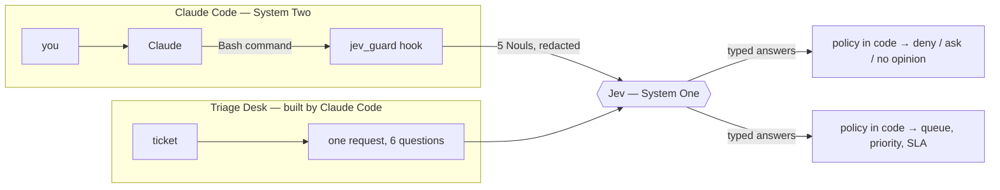

# ⚡ Jev + Claude Code — a case study

**What the "Jev + Claude Code" buzz actually means, tested with two working programs.** In both, TypeSafe's **Jev** makes the fast, typed decisions and **code** owns everything else. One is a support-triage app that Claude Code builds with Jev inside it. The other is a Claude Code safety hook where Jev judges the agent's own shell commands.

[](https://github.com/gsaini/jev-claude-code-case-study/actions/workflows/ci.yml)


> An independent learning project, not affiliated with TypeSafe, Anthropic, or Browser Use. Researched 2026-10-07; Jev and its ecosystem are weeks old, so re-check anything you rely on.

---

## TL;DR

- **Jev is not a model for Claude Code to run on.** It writes no text and calls no tools. It answers typed questions (Choice, Score, Noul) with probabilities, in roughly 100–500 ms, at **$42 per billion input tokens** with free output. "Jev + Claude Code" means two models working together: **Claude plans and writes (System Two); Jev makes the bounded calls inside the loop (System One).**
- **Four patterns are in use**, listed in [research](docs/research.md): Claude Code *builds apps* that use Jev; Jev *guards* Claude Code's tool calls; Jev as an *MCP tool* Claude Code calls; and Jev *driving a browser* for Claude. This repo builds the first two.
- **The headline numbers need care.** "193.6× faster, 444.6× cheaper" measures agreement with two frontier models, not correctness. Independent tests report roughly 5–25× faster, accuracy on par or slightly worse, and confident errors. The biggest lever independent testers found is **splitting one vague question into narrow ones**.
- **So this repo is built the way the evidence suggests:** narrow questions, policy in code, confidence gating, labeled evals, and a guard that **can only tighten** Claude Code's permissions, never loosen them.

## The two programs

| | **Triage Desk** (pattern A) | **Jev Guard** (pattern B) |
|---|---|---|
| What | Routes support tickets to a team, priority, and SLA | A `PreToolUse` hook that judges Claude's Bash commands |
| Jev's job | 6 questions per ticket in **one** request (Choice, Score, 4 Nouls) | 5 Nouls on each *ambiguous*, redacted command |
| Code's job | Thresholds, escalation, the SLA clock, every decision's reasons | Hard denies, secrets, a read-only fast path, and turning answers into deny / ask / no opinion |
| Fails safe because | Low confidence or "other" goes to a human review queue | It **never answers `allow`**; without Jev it has no opinion and Claude Code decides |
| Read | [docs/triage-desk.md](docs/triage-desk.md) | [docs/jev-guard.md](docs/jev-guard.md) |



## Quick start (offline, no key)

```bash
git clone https://github.com/gsaini/jev-claude-code-case-study.git
cd jev-claude-code-case-study
uv sync                                  # or: python -m venv .venv && .venv/bin/pip install -e . pytest

uv run triage-desk demo                  # 8 sample tickets
uv run triage-desk serve                 # web UI + JSON API at http://127.0.0.1:8765
uv run triage-desk eval                  # 40 labeled tickets
uv run jev-guard check "git push --force origin main"
uv run jev-guard eval                    # 61 labeled commands
uv run pytest -q                         # 64 tests
```

Offline, every answer comes from a **keyword baseline**, not Jev: the regex router a team typically has before a model. It's served through the **real TypeSafe SDK** via a mock transport, so the app code is identical either way. Offline numbers show the mechanics and the baseline; they are **not Jev's results**.

### With Jev

```bash
export TYPESAFE_API_KEY=...              # https://console.typesafe.ai/keys
uv run triage-desk eval --live --yes     # 40 requests, roughly 20–30K input tokens ≈ $0.001
uv run jev-guard eval --live --yes       # adds "Jev, five questions" and "Jev, one question"
```

### In Claude Code

Open the repo in Claude Code and accept the workspace trust prompt. Two things load from [`.claude/settings.json`](.claude/settings.json):

1. **The guard hook**, in **shadow mode**: Jev's opinions are logged to `.jev-guard/decisions.jsonl`, and only the deterministic code rules are enforced. Run `uv run jev-guard log` to see what enforce mode *would* have prompted for, then set `JEV_GUARD_MODE=enforce`. Put the key in `~/.config/jev-guard/key` (`chmod 600`) rather than in your shell, so the agent being judged doesn't inherit it.
2. **The official TypeSafe skill**, through `extraKnownMarketplaces` and `enabledPlugins`. Each person still installs it once: `claude plugin install typesafe@typesafe-ai`, then `/typesafe:typesafe-ai`.

## Results

### Measured offline: the keyword baseline (2026-10-07)

**Triage Desk**, 40 tickets, auto-route threshold 0.6:

| metric | keyword baseline | Jev |
|---|---|---|
| department accuracy | 68% | *not run yet* |
| auto-routed / accuracy of auto-routed | 50% / 90% | |
| **wrong auto-routes** | **2** | |
| security recall | **20%** (1 of 5) | |
| legal recall | 67% | |
| urgency exact / within one level | 40% / 82% | |
| cost | n/a (offline) | ≈ $0.001 expected |

Both wrong auto-routes are security incidents the keywords missed. *"It wasn't me"* about a strange sign-in went to the account team. *"Our private report opens without logging in"* went to **billing**, because "pri**vat**e" contains the billing keyword `vat`. That's the kind of keyword-router failure Jev is meant to replace. Whether it does is what the live run measures.

**Jev Guard**, 61 commands (30 routine, 24 risky, 7 catastrophic):

| | rules only | keyword baseline | Jev, five questions | Jev, one question |
|---|---|---|---|---|
| risky commands caught | 9/31 | 29/31 | *not run yet* | *not run yet* |
| **missed risky commands** | **22** | **2** | | |
| **extra prompts on routine work** | **0** | **4** | | |
| decided by code, no model call | 20/61 | 20/61 | 20/61 | 20/61 |

- **Rules alone** catch every catastrophic command and never bother you, but they miss 22 risky ones, such as `git push`, `terraform apply`, and `kubectl delete`. That gap is the job the model has.
- **Keywords** close most of it but prompt on `rm -rf node_modules`, `git push --dry-run`, and `docker run --rm`. These are exactly the boundary cases the Jev questions spell out in their criteria.
- One third of commands never reach a model at all.

> The keyword baseline for the guard was written by the same person who labeled the commands, so treat it as an optimistic baseline. Fill in the Jev columns with `--live` and compare. The interesting number is how **five questions** compare with **one**.

## What we learned

1. **Jev isn't Claude Code's model; it's Claude Code's System One.** Use it where a judgment repeats, is bounded, and is cheap to check: routing, gating, triage. Not for planning or writing.
2. **Decompose, then decide in code.** Narrow questions with boundary cases in their criteria, combined by code that can be tested and changed without new model calls (see the threshold sweep).
3. **A guard must only tighten.** A hook's `allow` skips Claude Code's permission prompt. Never let a probabilistic judge be the thing that approves.
4. **Decide before any side effect.** Our first hook logged before it printed, crashed on a missing directory, and lost a `deny` for `rm -rf /`. Now there's a [regression test](tests/test_guard.py) for it.
5. **Keep the judged agent's words out of the judge's input.** The guard sees the redacted command, never Claude's description of it. The key can live outside the agent's environment.
6. **Verify the claims yourself; it costs almost nothing.** Both live evals together cost well under a cent. "When Jev is wrong, it is usually sure of itself," so choose thresholds from labeled data, not from the confidence number alone.

## Repository layout

```text
src/jev_common/     client factory (live or offline), confidence formulas, keyword baseline over httpx2.MockTransport
src/triage_desk/    questions, policy, app, evals, CLI, stdlib web UI
src/jev_guard/      rules (deny / secrets / fast path / redaction), questions, engine, Claude Code hook, evals, CLI
data/               tickets.jsonl (40 labeled), commands.jsonl (61 labeled)
tests/              64 offline tests: SDK round trip, policy, hook protocol, never-allow, eval sanity
docs/               research · triage-desk · jev-guard · how-it-was-built
.claude/            settings.json: the hook, safe permissions, the TypeSafe skill marketplace
```

## Further reading

- [Research and sources](docs/research.md): the claims, the independent evaluations, and every integration found.
- Study notes in [awesome-software-engineering](https://github.com/gsaini/awesome-software-engineering): [Jev Ultrafast](https://github.com/gsaini/awesome-software-engineering/blob/main/notes/jev-ultrafast.md) · [Critique Agents as a Graph](https://github.com/gsaini/awesome-software-engineering/blob/main/notes/critique-agent-graph.md) · [Claude Code Prompt Patterns](https://github.com/gsaini/awesome-software-engineering/blob/main/notes/claude-code-prompt-patterns.md)
- Related repos: [harness-engineering-getting-started](https://github.com/gsaini/harness-engineering-getting-started) · [my-agentic-moments](https://github.com/gsaini/my-agentic-moments)

## License

[MIT](LICENSE).
