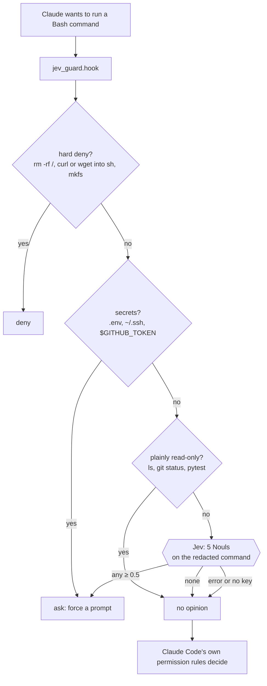

# Jev Guard: Jev inside Claude Code's own loop (pattern B)

Jev Guard is a Claude Code **`PreToolUse` hook** that runs before every Bash command. Code decides everything it can. Jev judges the rest. Policy in code turns those judgments into a decision.



## The rule that shapes everything: it only tightens

A `PreToolUse` hook can answer `allow`, `deny`, `ask`, or nothing. **`allow` skips the permission prompt** ([hooks docs](https://code.claude.com/docs/en/hooks#pretooluse-decision-control)). A probabilistic judge should never be the thing that waves a command through, so this hook **never answers `allow`**, and a test checks every labeled command in both modes to confirm it.

The consequence is a guard that fails safe by construction. If Jev is down, slow, rate-limited, or has no key, the hook has no opinion, and Claude Code behaves exactly as it would without the hook.

## The five questions ([`questions.py`](../src/jev_guard/questions.py))

"Is this command dangerous?" hides five judgments. Asked separately, each one is narrower, gets its own probability, and produces its own reason in the permission prompt:

| Question | "Yes" means | "No" includes (the boundary cases) |
|---|---|---|
| `destroys_data` | deletes or overwrites source, user data, databases, backups, volumes, cloud resources | build output, caches, `node_modules`, venvs, a `--rm` container |
| `leaves_machine` | push, publish, deploy, upload, merge, send a message, or a state-changing HTTP call | a GET, `git fetch`, a dry run |
| `discards_work` | force push, hard reset, `git clean`, discarding local changes | commits, new branches |
| `system_wide` | sudo, global installs, shell profiles, system settings | the project and its own venv |
| `exposes_secrets` | prints or sends credentials, or the whole environment | redacted values |

Jev 1.13 reads literally, so each question's **criteria** spell out its boundary cases. That is where TypeSafe's docs say to put them.

## What Jev sees, and what it doesn't

- **The redacted command only.** Bearer tokens, `KEY=value` secrets, `ghp_…`, `AKIA…`, and long tokens are stripped first ([`rules.py`](../src/jev_guard/rules.py)). The log stores the same redacted text.
- **Not Claude's `description` of the command.** That text is written by the agent being judged and could argue its own case. TypeSafe's docs say adversarial content in the state can move Jev's answer, so the agent's justification stays out. (A critic shouldn't read the author's justification either.)
- **Not your key, if you keep it in `~/.config/jev-guard/key`** (`chmod 600`). If `TYPESAFE_API_KEY` sits in your shell, every command Claude runs inherits it, and `printenv` would print it. The guard asks before `printenv`, but it's better for the key not to be there at all.

## Shadow first, then enforce

`JEV_GUARD_MODE=shadow` is the default, set in [`.claude/settings.json`](../.claude/settings.json). In shadow mode, Jev's opinions are only **logged**, to `.jev-guard/decisions.jsonl`. Code rules are deterministic, tested, and always enforced. After a few sessions:

```bash
uv run jev-guard log      # counts, plus "in enforce mode, the model would also have prompted for: …"
```

If those extra prompts look right, set `JEV_GUARD_MODE=enforce`. At that point you can safely broaden your `allow` rules (for example `Bash(git *)`), because the guard puts a prompt back in front of `git push --force` and `git reset --hard`. Claude Code's docs describe this combination: broad allow rules, with a hook that rejects specific commands.

## The bug we hit building it

The first version wrote its log line **before** printing its decision. On the first end-to-end run the log directory didn't exist, the hook crashed, and `rm -rf /` got **no deny**. A crashing hook is a non-blocking error in Claude Code, so the command would have gone ahead under the normal permission rules.

The fix: **decide and print first, then log as a best effort.** A regression test (`test_hook_still_denies_when_logging_fails`) points the log at a path that can't be created and checks that the deny still comes through. The general lesson: in a guard, every side effect comes after the decision.

## Running it

```bash
uv run jev-guard check "git push --force origin main"          # offline keyword baseline
uv run jev-guard check "git push --force origin main" --live   # Jev
uv run jev-guard eval                                          # rules only vs keyword baseline
uv run jev-guard eval --live --yes                             # + Jev with 5 questions vs Jev with 1 question
```
