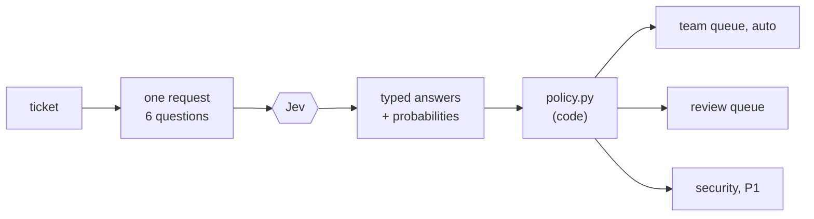

# Triage Desk: Jev inside an app that Claude Code builds (pattern A)

Triage Desk routes support tickets. Each ticket gets **one** TypeSafe request. Code turns the answers into a queue, a priority, a due time, and a list of reasons.



## The questions ([`questions.py`](../src/triage_desk/questions.py))

| Name | Primitive | Why it's shaped this way |
|---|---|---|
| `department` | Choice: billing / technical / account / sales / **other** | `other` is the no-match option, so the model is never forced into the wrong team |
| `urgency` | Score over four *described situations* | The levels describe situations ("blocked from doing their work"), not numbers, because Jev is weak at numeric scales |
| `security` | Noul | Asked separately, because "is it about security?" must never get lost inside the department choice |
| `legal` | Noul | Same: a narrow condition that policy can act on |
| `refund` | Noul, **speculative** | States its premise ("Assuming … billing") and is used only when the department is billing |
| `churn` | Noul | Tags the ticket for the account team |

All six go in one request. TypeSafe evaluates them in parallel, so the speculative `refund` question costs a few input tokens, not a second round trip.

## The policy ([`policy.py`](../src/triage_desk/policy.py))

Checked in order, and every decision records its reasons:

1. `security ≥ 0.5` → **security** queue, P1, and a person reads it, whatever the department confidence says.
2. `department = other` → **review**.
3. Department `confidence < 0.6` → **review**, with the two leading candidates shown ("account 0.65 vs sales 0.33").
4. Otherwise → **auto-routed** to the team.
5. `legal ≥ 0.5` keeps the team but takes away the auto-route.
6. SLA: urgency level → 72 / 24 / 8 / 1 hours, **added to the received time in code**. Jev never handles a date.

## The eval ([`evals.py`](../src/triage_desk/evals.py))

There are 40 labeled tickets in [`data/tickets.jsonl`](../data/tickets.jsonl), several of them deliberately hard: a stolen login described without any security keyword, "I'm *not* asking for a refund", and a GDPR request that threatens the regulator.

The metric that matters most is **wrong auto-routes**: tickets sent to the wrong team *with no person looking first*. Sending a ticket to review costs someone a minute; a wrong auto-route can cost the customer a day.

The **threshold sweep** re-decides the same answers at thresholds from 0.0 to 0.9. Because the policy is code, moving the threshold needs **no new model calls**, so you can choose it from the data.

## Running it

```bash
uv run triage-desk demo                      # 8 sample tickets, offline keyword baseline
uv run triage-desk serve                     # http://127.0.0.1:8765 — form + JSON API (POST /api/triage)
uv run triage-desk eval                      # the 40-ticket eval, offline
uv run triage-desk eval --live --yes         # the same against Jev (TYPESAFE_API_KEY)
```

The TypeSafe key stays on the server: the browser only ever sees decisions.
